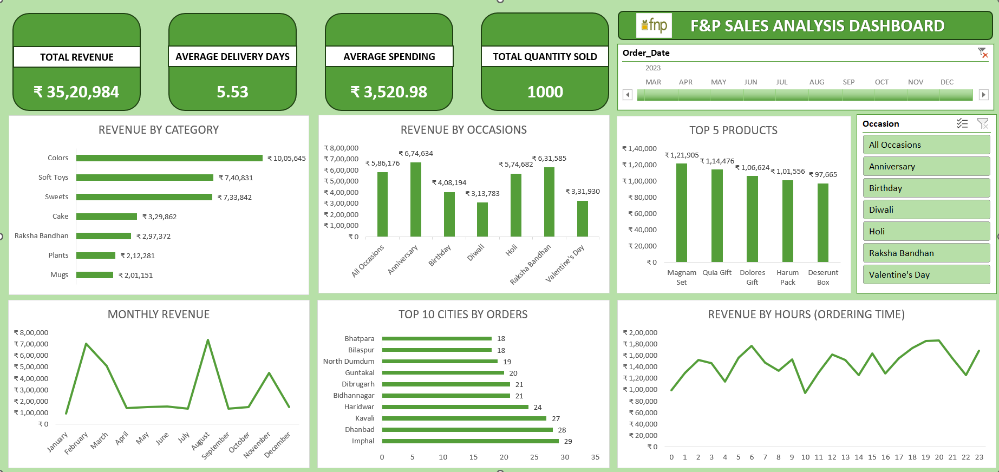

# F&P Gifts Sales Analysis (Excel Dashboard)

Excel dashboard practice project, built while learning pivot tables, slicers and timelines.

**Dataset:** sample gifting-business data with 3 tables (customers, orders, products), 1,000 orders, January to December 2023. Source: [add link if you have it]

**Tools:** Excel Pivot Tables, Pivot Charts, Slicer (Occasion), Timeline (Order Date), Data Model

## Business questions
1. Which products and categories bring the most revenue?
2. When do customers buy, by month, occasion and hour of the day?
3. How fast are orders delivered?

## Key numbers
| Metric | Value |
|---|---|
| Total revenue | ₹35.21 lakh |
| Orders | 1,000 |
| Units sold | 3,045 |
| Average spend per order | ₹3,521 |
| Average delivery time | 5.53 days |

## My analysis

**Findings**
1. **Three categories bring 70% of revenue.** Colors (₹10.06 lakh, 28.6%), Soft Toys (21.0%) and Sweets (20.8%). Cake, Plants and Mugs together bring less than 21%.
2. **Revenue is very seasonal.** February, March, August and November bring 68% of total revenue. The other 8 months bring only 2.7% to 4.5% each. Raksha Bandhan alone brought ₹6.32 lakh (17.9%) in a 10-day window (20 to 29 August).
3. **Delivery is not faster in peak season.** 32% of all orders took 8 days or more. Average delivery was still 5.3 to 5.8 days during Valentine's Day, Holi and Raksha Bandhan, so the speed did not improve when timing matters most.

**Recommendation**
Plan stock and delivery capacity before the peak events (Valentine's Day and Holi, Raksha Bandhan, Diwali), with a focus on the Colors, Soft Toys and Sweets categories. Aim to cut delivery time in these windows, because gifts have a fixed date.

**Limitations**
- Only 1,000 orders and one year of data, so patterns may not hold in other years.
- The data looks synthetic (placeholder product names). Treat the results as practice, not real business advice.
- Orders come from 301 cities, with at most 9 orders per city, so the city chart is not reliable for decisions.
- Revenue is price x quantity. There is no cost or profit data, so profit by category is unknown.

## Files
- `FnP_Gifts_Sales_Dashboard.xlsx`: the full workbook (data, pivot tables, dashboard)
- `dashboard.png`: dashboard screenshot
